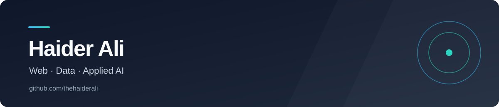

  
    
  <a href="https://thehaiderali.com/">Website</a> ·
  <a href="https://www.linkedin.com/in/thehaideraly/">LinkedIn</a> ·
  <a href="https://github.com/thehaiderali?tab=repositories">Repositories</a>
    
  

### About

I'm a software developer interested in web applications, data engineering, and applied AI. I learn by building projects and sharing the work here.

### Selected work

| Project | What it explores |
| --- | --- |
| [S&P 500 lakehouse](https://github.com/thehaiderali/dav-medallion-pipeline) | A Python and Databricks pipeline for market data, with Bronze and Silver tables, validation, and audit logs. |
| [CONTREON](https://github.com/thehaiderali/contreon) | A team project for creator subscriptions, built with React, Node.js, MongoDB, and Stripe. |
| [WebSocket Tic Tac Toe](https://github.com/thehaiderali/game) | A real-time two-player game using JavaScript and WebSockets. |

### Tools I've used

`Python` · `JavaScript` · `TypeScript` · `React` · `Node.js` · `SQL` · `Databricks`

  <a href="https://thehaiderali.com/">thehaiderali.com</a>

